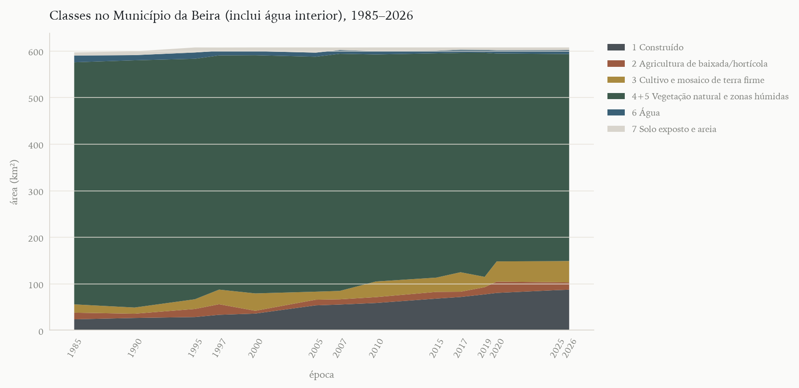
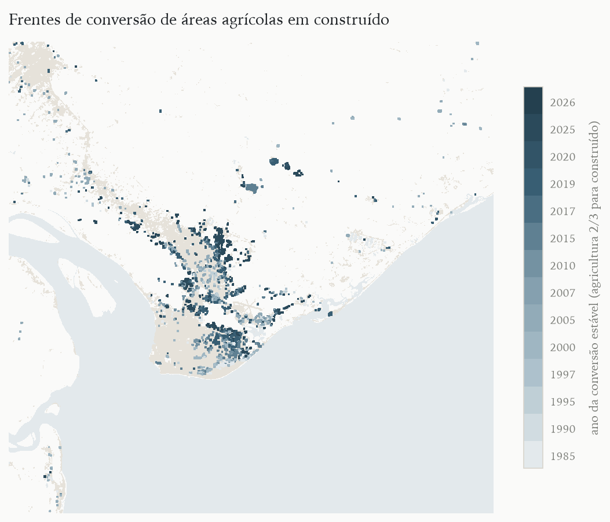

# Resumo

A Beira, segunda cidade portuária de Moçambique, foi construída sobre uma planície de pântanos, mangais e baixadas inundáveis na foz do Púnguè, onde o cultivo de arroz e hortícolas sustentou parte da população periurbana. Ao contrário do que ocorreu em Maputo, nenhum dos planos da cidade consultados, do anteprojeto colonial de 1943 ao Masterplan 2035, reservou solo para a agricultura: as terras húmidas foram tratadas como obstáculo a drenar ou como reserva de retenção de cheias. Este artigo reconstitui a trajetória dessas terras entre 1985 e 2026 com um painel de imagens Landsat nos anos censitários e intercensitários, classificado por Random Forest e avaliado por amostra estratificada interpretada às cegas, e com a revisão dos planos e da literatura. A medida central é a fração construída dentro de perímetros independentes da classificação agrícola, estimada de três formas. Entre 1985–1997 e 2017–2025, a fração construída do município multiplicou-se por 1,9 a 2,8, conforme a estimativa, e a das baixadas passou de 1,5–6,0% para 4,0–13,1%; nos mangais de referência não se detecta aumento da construção. As três estimativas não são independentes entre si, e a validação, de um só ano, indica que o construído é subestimado. Não há séries oficiais abertas de produtores ou de produção agrícola urbana para a cidade. A comparação com Maputo e com outras cidades costeiras mostra que, na Beira, o conflito não opõe apenas agricultura e loteamento, mas também agricultura e infraestrutura verde: bacias de retenção e parques financiados por doadores deslocaram agricultores das mesmas baixadas que pretendem proteger. Argumenta-se que a adaptação climática da cidade deve reconhecer a agricultura de baixada como uso compatível com a retenção de cheias.

**Palavras-chave:** agricultura urbana; Beira; zonas húmidas; uso do solo; sensoriamento remoto; planejamento urbano; adaptação climática.

# Abstract

Beira, Mozambique's second port city, was built on a plain of swamps, mangroves and flood-prone lowlands at the mouth of the Púnguè river, where rice and vegetable cultivation has supported part of the peri-urban population. Unlike Maputo, none of the city's plans consulted, from the 1943 colonial draft plan to the Masterplan 2035, reserved land for agriculture: wetlands were treated either as an obstacle to be drained or as reserve land for flood retention. This article reconstructs the trajectory of these lands from 1985 to 2026 using a Landsat image panel for census and intercensal years, classified with Random Forest and assessed with a blind stratified sample, together with a review of plans and literature. The main indicator is the built-up share within perimeters defined independently of the agricultural classification, estimated in three ways. Between 1985–1997 and 2017–2025 the built-up share of the municipality increased by a factor of 1.9 to 2.8, depending on the estimate, and that of the lowlands rose from 1.5–6.0% to 4.0–13.1%; no increase in building is detected in reference mangroves. The three estimates are not independent, and the single-year assessment indicates that built-up area is underestimated. No open official series on urban producers or agricultural output exist for the city. Comparison with Maputo and other coastal cities shows that in Beira the conflict sets agriculture not only against plot subdivision but also against green infrastructure: donor-funded retention basins and parks displaced farmers from the very lowlands they aim to protect. We argue that the city's climate adaptation should recognise lowland agriculture as a land use compatible with flood retention.

**Keywords:** urban agriculture; Beira; wetlands; land use change; remote sensing; urban planning; climate adaptation.

# 1 Introdução

A Beira nasceu em 1887, quando Portugal afirmou a sua soberania na ponta Chiveve, numa estreita faixa arenosa entre os rios Púnguè e Búzi (FERNANDES; MEALHA; MENDES, 2016, p. 156), e cresceu sobre terrenos que os relatos coloniais descreviam como um "enorme lameiro líquido, gerador de humidades e pestilências" (FERNANDES; MEALHA; MENDES, 2016, p. 156). Quase um século e meio depois, a cidade continua definida pela relação com a água: a sua altitude média é de cerca de 14 m (MÁRIO; UACANE, 2023, p. 251), grande parte da área construída é sujeita a inundação (DELTARES; WITTEVEEN+BOS, 2013, p. 7), e em março de 2019 o ciclone Idai danificou mais de 80% da cidade (ICLEI AFRICA, 2025). Entre o centro de cimento e o mar, e nas planícies do interior do município, estendem-se baixadas, caniçais, mangais e campos de arroz que formam o equivalente beirense das zonas verdes de Maputo.

O equivalente, porém, é imperfeito, e é dessa imperfeição que este artigo parte. Em Maputo, a agricultura periurbana foi reconhecida em 1979–1980 como base do abastecimento da capital e ganhou um gabinete próprio, as zonas verdes entraram nos planos de 1985 e 2008, e mesmo assim a fração construída das baixadas e das zonas agrícolas planejadas cresceu continuamente desde 1985 (SOBREIRA, 2026). Na Beira, segundo Shannon, o governo central apoiou os agricultores urbanos desde o início dos anos 1980 (SHANNON, 2019, p. 9), mas as fontes abertas não registram zonas verdes demarcadas na cidade, e a documentação de planejamento mais recente trata as baixadas como áreas de retenção de cheias e de expansão urbana. Num estudo de campo sobre a política de solo da cidade, Shannon identificou no município uma "policy of total agricultural displacement" (SHANNON, 2019, p. 9); outro trabalho do mesmo grupo descreve a visão municipal de desenvolvimento como um "systematic displacement of agricultural land use from the city" (SHANNON et al., 2018, p. 13).

O artigo tem três objetivos. O primeiro é reconstituir, a partir de imagens orbitais, a ocupação construída das baixadas, dos mangais e das áreas agrícolas da Beira nos anos censitários (1997, 2007 e 2017; 1980 apenas no painel visual) e intercensitários quinquenais até 2026, com o mesmo método aplicado a Maputo, para tornar os dois casos comparáveis. O segundo é situar essa trajetória na história dos planos urbanísticos da cidade e nos conflitos documentados de uso do solo. O terceiro é discutir, em perspectiva comparada, o que o caso da Beira acrescenta ao debate sobre agricultura urbana em cidades africanas: o confronto entre a agricultura de baixada e uma agenda de adaptação climática que também reivindica as terras húmidas.

A seção 2 resume o debate sobre agricultura urbana em África. A seção 3 trata da formação da cidade e das suas terras húmidas, e a seção 4 dos planos urbanísticos. A seção 5 descreve materiais e métodos, a seção 6 apresenta os resultados e a seção 7 discute o caso em perspectiva comparada.

# 2 Agricultura urbana em cidades africanas

## 2.1 Definição e evidência sobre pobreza e segurança alimentar

A agricultura urbana e periurbana é definida menos pela localização do que pela integração no sistema econômico e ecológico da cidade: usa recursos urbanos, abastece mercados urbanos e sofre as pressões próprias da cidade, como a competição pelo solo (MOUGEOT, 2000). Os estudos fundadores dos anos 1990 sustentaram, contra a visão do cultivo urbano como resquício rural, que se tratava de estratégia de sobrevivência e de atividade comercial em expansão (EGZIABHER et al., 1994; PRAIN; KARANJA; LEE-SMITH, 2010), associada em parte às crises urbanas e ao ajuste estrutural (BRYLD, 2003) e antiga, embora ignorada pelas políticas (RAKODI, 1988).

Na década de 2010 a promessa de que a agricultura urbana reduziria a pobreza e a fome urbanas foi posta à prova. Os inquéritos da rede AFSUN em onze cidades da África Austral concluíram que a produção urbana de alimentos não era particularmente significativa para a maioria dos agregados (CRUSH; HOVORKA; TEVERA, 2011), e análises posteriores não encontraram efeito protetor consistente sobre a insegurança alimentar dos mais pobres (FRAYNE; MCCORDIC; SHILOMBOLENI, 2014). Em quinze países, a participação da agricultura urbana na renda dos agregados mostrou-se limitada, embora associada à diversidade da dieta (ZEZZA; TASCIOTTI, 2010); revisões sistemáticas encontraram contributos substanciais apenas em alguns contextos (POULSEN et al., 2015) e evidência de qualidade baixa e resultados mistos (WARREN; HAWKESWORTH; KNAI, 2015). Crush e Riley observam que a promoção da agricultura urbana foi a principal intervenção municipal de segurança alimentar na África do Sul, sem evidência de que tenha alcançado os mais vulneráveis (CRUSH; RILEY, 2019, p. 49), e Battersby e Haysom lembram que quem cultiva, em geral, não são os mais pobres (BATTERSBY; HAYSOM, 2019, p. 58). O ceticismo deslocou a pergunta para o acesso aos alimentos e para os sistemas alimentares urbanos (BATTERSBY, 2011), sem eliminar dois matizes: a agricultura urbana tende a dominar nichos de perecíveis, como as folhosas de Dar es Salaam (WESSELS; HEMERIJCKX, 2024, p. 3), e o seu contributo para a cidade, como emprego e abastecimento, é distinto do seu efeito sobre a segurança alimentar de cada agregado.

Na Beira, a questão é agravada pela vulnerabilidade a choques. Um relatório sobre os mercados alimentares da cidade depois do Idai refere dependência de importações e de produtores locais cuja "production was decreasing due to loss of land" (GAIN; RESILIENT CITIES NETWORK ET AL, 2021, p. 13), e recomenda mapear espaços para agricultura urbana e rever o zoneamento (GAIN; RESILIENT CITIES NETWORK ET AL, 2021, p. 22).

## 2.2 Serviços ambientais, terra e planejamento

A literatura recente reenquadrou a agricultura urbana como componente da adaptação climática: várzeas e baixadas cultivadas retêm água de cheia e reduzem o escoamento, ainda que as medições diretas em cidades africanas sejam escassas (LWASA et al., 2014; LWASA et al., 2015). Em Kano, o cultivo de baixios funcionava como zona tampão de inundações, e os agricultores temiam a venda dessas terras para construção (LYNCH; BINNS; OLOFIN, 2001). Os riscos, como a irrigação com águas residuais e a contaminação por metais e patógenos, são igualmente documentados, e a orientação dominante é geri-los e não proibir a prática (QADIR et al., 2010; ANTWI-AGYEI et al., 2016).

O ponto de maior consenso é que a insegurança fundiária é a principal ameaça à agricultura urbana (LYNCH; BINNS; OLOFIN, 2001; DAVIES et al., 2021; FAO, 2012), e que a visão modernista do planejamento tendeu a excluir a agricultura do desenho da cidade (MBIBA, 1994; SMIT, 2019, p. 96). O caso da Beira acrescenta uma variante a esse quadro. Ali, a exclusão não vem apenas do loteamento e do mercado de terras, mas também de projetos de drenagem e de infraestrutura verde que disputam as mesmas baixadas em nome da resiliência climática (SHANNON et al., 2018; SHANNON, 2019).

# 3 A cidade e as suas terras húmidas

## 3.1 Uma cidade sobre o pântano (1887–1975)

A soberania portuguesa na ponta do Chiveve foi afirmada em 1887; a região foi concedida em 1890 à Companhia de Moçambique, que governou a Beira até 1942, e a povoação foi elevada a cidade em 1907 (FERNANDES; MEALHA; MENDES, 2016, p. 156–159). O núcleo urbano formou-se "contornando as áreas pantanosas" (HPIP, [s.d.]), e a história urbana do período colonial é em grande medida a história da conquista desses terrenos por aterros e drenagens. Em 1931, um esquema de drenagem para 1 400 ha ao norte e a leste da cidade foi descartado, segundo o HPIP, por ter "o inconveniente de impedir a urbanização dos terrenos beneficiados" (HPIP, [s.d.]). A população passou de cerca de 20 000 habitantes em 1928 para 45 000 em 1960 (HPIP, [s.d.]).

Como em outras cidades moçambicanas, a Beira dividiu-se entre a cidade de cimento e os bairros de caniço da periferia, em que a agricultura familiar se misturava com a habitação (MAIDJELELE, 2023, p. 59–60). Nenhuma das fontes coloniais lidas para este estudo menciona a agricultura como uso do solo a planejar; as terras húmidas aparecem apenas como problema sanitário e de engenharia (HPIP, [s.d.]; FERNANDES; MEALHA; MENDES, 2016).

## 3.2 Independência, guerra e crescimento (1975–2000)

Depois da independência, o Estado moçambicano criou em 1983 o Instituto Nacional de Planeamento Físico e promoveu a demarcação de "Zonas Verdes (Green Zones) for agricultural production around Mozambican cities" (SIDAWAY, 1993, p. 3 do arquivo). Os dados disponíveis sobre essa política, porém, referem-se a Maputo (SIDAWAY, 1993, p. 7–8 do arquivo), e não foi encontrada fonte aberta sobre a demarcação de zonas verdes na Beira. Shannon refere, contudo, décadas de apoio institucional do governo central aos agricultores urbanos da cidade desde o início dos anos 1980 (SHANNON, 2019, p. 9). Durante a guerra civil (1976–1992), deslocados ocuparam vazios urbanos e espaços periféricos antes usados pela agricultura (MAIDJELELE, 2023, p. 61). Segundo o Atlas of Urban Expansion, a extensão urbana da Beira passou de 2 207 ha em 1991 para 2 631 ha em 2001 (ATLAS OF URBAN EXPANSION, 2013).

## 3.3 Expansão, doadores e ciclones (2000–2026)

Entre 2001 e 2013 a extensão urbana, na definição do Atlas, saltou para 12 153 ha, mas três quartos do acréscimo de área construída do período foram classificados pela fonte como inclusão de áreas já envolvidas pela extensão urbana, e não como expansão para fora dela (ATLAS OF URBAN EXPANSION, 2013). Na década de 2010 a Beira tornou-se um laboratório de adaptação climática financiado por doadores: o Banco Mundial escolheu a cidade para o seu programa piloto de resiliência climática, que financiou a reabilitação da drenagem (SHANNON et al., 2018, p. 12–13); a cooperação alemã financiou a dragagem do rio Chiveve (KFW DEVELOPMENT BANK, 2023); e a cooperação neerlandesa apoiou o Masterplan Beira 2035 (DELTARES; WITTEVEEN+BOS, 2013). Em paralelo, foi aprovada em 2012 a zona económica especial de Manga-Mungassa, com 217 ha alocados e 1 000 ha reservados à expansão (SHANNON et al., 2018, p. 8).

O ciclone Idai tocou terra perto da Beira em 14 de março de 2019, com ventos de categoria 4 (CENOE INFORMATION SECTOR (ACAPS, IFRC, MAPACTION, OCHA, REACH, UNDAC ET AL.), 2019, p. 5). Na região central do país, pelo menos 715 378 ha de terra cultivada foram inundados (CENOE INFORMATION SECTOR (ACAPS, IFRC, MAPACTION, OCHA, REACH, UNDAC ET AL.), 2019, p. 10), e o plano municipal de recuperação estimou em cerca de 70% as casas parcial ou totalmente destruídas (CONSELHO MUNICIPAL DA BEIRA, 2019, p. 14). Seguiram-se a tempestade Chalane, em dezembro de 2020, e o ciclone Eloise, em janeiro de 2021, com epicentro no vizinho distrito de Búzi (ACAPS, 2021, p. 1–2). Nenhum dos sítios de reassentamento pós-Idai ficou dentro dos limites municipais da Beira (JACOBS; RIBEIRO DE ALMEIDA, 2020, p. 18). Entre 2019 e 2021, segundo dados do INGD reunidos por Mário e Uacane, as cheias afetaram culturas de 300 famílias em bairros de risco da cidade (MÁRIO; UACANE, 2023, p. 256–257).

## 3.4 O que se sabe sobre a agricultura urbana da Beira

A literatura aberta sobre a agricultura urbana da Beira é escassa e qualitativa. Os estudos de Shannon e coautores descrevem uma agricultura praticada sobretudo por mulheres em planícies inundáveis, com arrozais na baixada central de Maraza e nas planícies húmidas de Mungassa (SHANNON et al., 2018, p. 13–14; ICLEI AFRICA, 2026b). O único estudo quantitativo recente, baseado no produto global Impact Observatory de 10 m, estimou a classe de culturas no município em 8,25 km² (1,25%) em 2017, 2,70 km² em 2019 e 7,06 km² em 2023, contra uma área construída que passou de 103,81 para 124,96 km² (SIUEIA JÚNIOR et al., 2025, p. 90). Esse produto, porém, classifica os arrozais inundados como vegetação inundada, e não como cultura (SIUEIA JÚNIOR et al., 2025, p. 89), de modo que subestima justamente a agricultura de baixada. Não foram encontradas em acesso aberto séries de produtores, de áreas por bairro, de produção por cultura ou de efetivos pecuários para a cidade; os recenseamentos e inquéritos agrários do INE, que poderiam supri-las, estavam inacessíveis durante a pesquisa (seção 6.4).

# 4 Os planos urbanísticos e as terras húmidas

## 4.1 Planos coloniais: aterrar, drenar, zonear

A cadeia de planos da Beira começa com a planta de Joaquim José Machado, de cerca de 1893, continuada pela planta da Companhia de Moçambique de 1899, e inclui estudos de 1898 e de 1921–1932 que nunca foram executados por falta de meios (HPIP, [s.d.]) (Quadro 1). O primeiro plano geral de expansão foi o Ante-Projecto de Urbanização da Cidade da Beira, de 1943, do engenheiro Joaquim de Oliveira Ribeiro Alegre e do arquiteto José Luís Porto (HPIP, [s.d.]; FERNANDES; MEALHA; MENDES, 2016, p. 159) (Figura 1). O plano zonava a cidade por grupos populacionais, com bairro europeu a sul do Chiveve, bairros asiáticos e o bairro africano da Manga, e previa aterros e drenagem dos pântanos; o seu único grande espaço livre era o próprio Chiveve, transformado em lago com campo de golfe, "um grande espaço livre, necessário para arejamento e desafogo da cidade" (HPIP, [s.d.]). Seguiram-se o esboço de Plano Regulador de Carlos Camelo (1961), julgado incompleto, e a missão de Leopoldo de Almeida (1965–1966), que tratou o plano de 1943 "como um plano definitivamente ultrapassado" e submeteu um novo plano regulador sem aprovação ministerial até 1969 (HPIP, [s.d.]). Sidaway resume os planos coloniais da Beira e de Lourenço Marques como "focused on the expansion of the physical infrastructure" (SIDAWAY, 1993, p. 5 do arquivo).

![Figura 1 – Ante-Projecto de Urbanização da Cidade da Beira, de Joaquim de Oliveira Ribeiro Alegre e José Porto, 1943, com perspetiva. Fonte: Figura 7 de (FERNANDES; MEALHA; MENDES, 2016, p. 159), obtida via Redalyc (https://www.redalyc.org/pdf/1931/193143596011.pdf); autores: Joaquim de Oliveira Ribeiro Alegre; José Porto; data: 1943; detentor: fonte indicada na legenda: Portugal (1946); detentor original não verificado. Situação de direitos: reprodução com citação; direitos do original não verificados.](../dados/fig/artigo/fig1_plano_1943.jpg)

Quadro 1 – Planos urbanísticos e projetos relativos à Beira e às suas terras húmidas, 1893–2022

| Ano | Plano ou projeto | Autor/órgão | Aprovado | Agricultura; verde e mangal | Fonte |
|---|---|---|---|---|---|
| 1893 | Primeira planta da povoação da Beira (malha regular, ruas e bairros) | Joaquim José Machado (engenheiro) | Não confirmado | sem tratamento nas fontes lidas; núcleo genético contornando áreas pantanosas; sem plano de zonas verdes | (HPIP, [s.d.]) |
| 1898 | Projecto de Loteamento da Beira (1898), detalhe | n.i. | Não confirmado | sem tratamento nas fontes lidas | (FERNANDES; MEALHA; MENDES, 2016) |
| 1898 | Estudo urbanístico de porto e ferrovia | Costa Serrão (engenheiro) | Não | sem tratamento nas fontes lidas | (HPIP, [s.d.]) |
| 1899 | Planta da Beira em 1899 (planta de urbanização da Companhia de Moçambique) | Companhia de Moçambique (continua a planta de Machado) | Não confirmado | sem tratamento nas fontes lidas | (HPIP, [s.d.]; FERNANDES; MEALHA; MENDES, 2016) |
| 1925 | Planta da Beira de 1925 (doca e cais em construção) | Carlos Roma Machado Faria e Maia | Não confirmado | sem tratamento nas fontes lidas | (HPIP, [s.d.]) |
| 1929 | Projecto de Urbanização e Alargamento da Cidade da Beira (e urbanização da praia do Macuti) | Carlos Rebelo de Andrade (arq.), a partir da planta da Comissão de Ampliação (1927) | Não | sem tratamento nas fontes lidas | (HPIP, [s.d.]) |
| 1931 | Esquema de drenagem de 1.400 ha ao norte e leste da cidade (salubridade) | eng. Harrison (Instituto Ross, Londres) | Não | sem tratamento (drenagem de terrenos); drenagem de áreas húmidas; 'tinha o inconveniente de impedir a urbanização dos terrenos beneficiados' | (HPIP, [s.d.]) |
| 1943 | Ante-Projecto de Urbanização da Cidade da Beira | Joaquim de Oliveira Ribeiro Alegre (eng.) e José Luís Porto (arq.) | Sim (Ministro das Colónias, 12/09/1947, segundo HPIP) | sem menção a agricultura nas fontes lidas; zonamento étnico e funcional; Chiveve em lago e campo de golfe como espaço livre; contrato incluía drenagem dos pântanos; sem menção a mangal | (HPIP, [s.d.]; FERNANDES; MEALHA; MENDES, 2016) |
| 1961 | Plano Regulador da Beira (esboço) | Carlos Veiga Pinto Camelo (arq.) | Não (julgado incompleto) | sem tratamento nas fontes lidas | (HPIP, [s.d.]) |
| 1964 | Esboceto de Centro Cívico e Comercial no local do lago do Chiveve | João Afonso Garizo do Carmo (arq.) | Não | sem tratamento; reverte o lago/espaço livre do plano de 1943 | (HPIP, [s.d.]) |
| 1966 | Plano Regulador da Beira / Plano Regulador de Manica e Sofala, zonificação do bloco Beira-Manga-Dondo | missão de Leopoldo de Castro Neves de Almeida (com Morais Veloso e V. Martinho) | Não (sem aprovação ministerial em 1969) | sem tratamento nas fontes lidas; inclui estudo de integração de áreas reservadas a bairros populares (Morais Veloso) | (HPIP, [s.d.]) |
| 1975 | Planeamento urbano pós-independência (INPF 1983; Zonas Verdes em cidades) | INPF / Gabinete das Zonas Verdes (Maputo, 1980) | Não confirmado | Zonas Verdes agrícolas demarcadas 'around Mozambican cities'; Beira não detalhada; mapeamento de terra fértil nas Zonas Verdes (Maputo) | (SIDAWAY, 1993) |
| 2012 | Reabilitação do rio Chiveve e infraestrutura verde (parque de 17 ha, mangal) | CES/Inros Lackner (projeto); KfW; Banco Mundial | Sim (projeto executado) | sem agricultura; mangal 5,40 ha (2004), 6 ha (2012), 2,8 ha após fase 1; replantio | (CES CONSULTING ENGINEERS SALZGITTER; INROS LACKNER, 2020; WORLD BANK, 2021) |
| 2013 | Plano diretor de drenagem da Beira (1.ª de 3 fases: 9,3 km de canais e bacia de retenção de Maraza) | TPF Planege (empresa portuguesa) | Não confirmado | bacia de retenção sobre baixada de arroz, desloca 490 agricultores; bacia de retenção de cerca de 25 ha | (SHANNON et al., 2018; WORLD BANK, 2021) |
| 2013 | Masterplan Beira 2035 | Deltares; Witteveen+Bos; Wissing; NIRAS; VandenBroek | Sim (Município, 2014) | sumário sem menção a agricultura; áreas designadas para retenção e drenagem; parar concessões em áreas de retenção | (DELTARES; WITTEVEEN+BOS, 2013; CONSELHO MUNICIPAL DA BEIRA, 2019; MOÇAMBIQUE, 2019) |
| 2018 | GreenInfra4Beira: infraestrutura verde para Chota (700 ha) | Witteveen+Bos; Deltares; Alterra; Wissing | Não confirmado | área 'originally low-lying agricultural land'; infraestrutura verde e retenção natural | (WITTEVEEN+BOS, 2018) |
| 2019 | Beira Municipal Recovery and Resilience Plan (Vol. 1) | Município da Beira com Governo dos Países Baixos, UN-Habitat, Arcadis | Não confirmado | não nas pp. 1-15; capítulos H (infraestrutura verde) e A2 não lidos; não nas pp. 1-15 | (CONSELHO MUNICIPAL DA BEIRA, 2019; MOÇAMBIQUE, 2019) |
| 2022 | Plano de Estrutura Urbana da Cidade da Beira (PEU) e seu diagnóstico | autoria não identificada (entregue pelo governo provincial) | Não confirmado (aprovação não confirmada) | não verificado (diagnóstico não aberto); não verificado | (RÁDIO MOÇAMBIQUE, 2022) |

Fonte: elaboração própria a partir de fontes/planos.csv e das fichas de leitura citadas. Nota: “n.i.” = não identificado nas fontes lidas; a entrada de 1975 refere-se ao programa nacional de zonas verdes.

Em Lourenço Marques, o plano de 1955 de Aguiar criou uma zona rural de proteção em torno da cidade, de função urbana e não agrícola, e só o plano de estrutura de 1985, já depois da independência, delimitou zonas verdes agrícolas (SOBREIRA, 2026). Nenhum dos planos da Beira consultados reserva solo para a agricultura.

## 4.2 Planos atuais: retenção, drenagem e expansão

O Masterplan Beira 2035, concluído em novembro de 2013 e aprovado pelo município em 2014 (CONSELHO MUNICIPAL DA BEIRA, 2019, p. 15), parte do diagnóstico de que "large parts of the built up areas are prone to flooding" (DELTARES; WITTEVEEN+BOS, 2013, p. 7) e propõe "designated areas for water retention and drainage" (DELTARES; WITTEVEEN+BOS, 2013, p. 9). Entre as ações imediatas, pede para "Stop the current uncontrolled issuing of land use concessions" em áreas que deveriam ser reservadas à retenção (DELTARES; WITTEVEEN+BOS, 2013, p. 9). O sumário executivo, única parte do plano obtida em acesso aberto, não menciona a agricultura.

A execução seguiu dois eixos que incidem sobre as terras húmidas. O primeiro é a drenagem: a reabilitação de 9,3 km de canais coloniais e a construção de uma bacia de retenção circular de cerca de 25 ha na planície central de Maraza, "an area historically used for rice cultivation", implicaram o despejo de 490 pequenos agricultores, cerca de 610 parcelas, compensados em dinheiro, com 5 000 meticais por agregado, e não com a terra de substituição prevista (SHANNON et al., 2018, p. 13–14); em outro trabalho, o mesmo autor refere o valor por parcela (SHANNON, 2019, p. 9). O segundo é a infraestrutura verde: a reabilitação do Chiveve, com lagoa de maré, restauração de mangal e um parque de 17 ha (WORLD BANK, 2022), e o projeto GreenInfra4Beira para o bairro de Chota, de cerca de 700 ha, área que "originally consisted of low-lying agricultural land" (WITTEVEEN+BOS, 2018). As fontes divergem quanto à dimensão do parque do Chiveve: 17 ha no relatório do Banco Mundial, área de projeto de 20 ha no relatório técnico (CES CONSULTING ENGINEERS SALZGITTER; INROS LACKNER, 2020, p. 21 do arquivo). O mesmo relatório técnico registra que a obra reduziu o mangal da área de estudo de cerca de 6 ha em 2012 para 2,8 ha depois da primeira fase, com replantio posterior (CES CONSULTING ENGINEERS SALZGITTER; INROS LACKNER, 2020, p. 30–31 do arquivo).

O plano de recuperação e resiliência elaborado depois do Idai prevê novas extensões urbanas, como a zona residencial de Maraza e o parque industrial da Munhava, e uma grande bacia de retenção em Rio Maria (CONSELHO MUNICIPAL DA BEIRA, 2019, p. 13–15). Em agosto de 2022 o governo provincial entregou ao município um Plano de Estrutura Urbana que "deverá ser aprovado pela Assembleia Municipal" (RÁDIO MOÇAMBIQUE, 2022); nem o texto do plano nem a sua aprovação puderam ser confirmados em fonte aberta. No quadro nacional, o regulamento do solo urbano prevê zonas de proteção ambiental nos planos de estrutura, mas não obriga a reservar solo agrícola (MOÇAMBIQUE, 2006; MOÇAMBIQUE, 2008).

Shannon interpreta essa trajetória como a sujeição do uso do solo urbano a duas políticas incompatíveis: a do município, cujo Masterplan supõe o deslocamento sistemático da agricultura para fora da cidade, e a do governo distrital, que declarou a intenção de continuar o apoio técnico e a regularização fundiária dos agricultores urbanos (SHANNON, 2019, p. 9). Segundo o autor, a maioria dos agricultores afetados pela drenagem foi compensada informalmente com 5 000 meticais, o que contrariou a própria política municipal (SHANNON, 2019, p. 9).

# 5 Materiais e métodos

## 5.1 Área de estudo e unidades de análise

A análise cobre um retângulo de 40 × 39 km (34,72–35,10° E; 19,60–19,95° S), que contém a cidade, a maior parte de Nhangau e o estuário do Púnguè, numa grade de 30 m em projeção UTM 36S (Figura 2). As unidades de agregação são os cinco postos administrativos e os 26 bairros da base administrativa oficial (OCHA, 2026). O polígono municipal dessa base tem 648,3 km², dos quais 607,2 km² (94%) estão dentro do retângulo; ficam de fora faixas estreitas nos extremos oeste e leste do município, e os resultados referem-se à parte coberta; a área do município varia entre fontes (633 km² em Mário e Uacane, 658 km² em Siueia e coautores) (MÁRIO; UACANE, 2023, p. 251; SIUEIA JÚNIOR et al., 2025, p. 88), e as comparações com outros estudos levam essa diferença em conta.

## 5.2 Épocas e imagens

As épocas seguem os anos dos recenseamentos gerais de Moçambique (1980, 1997, 2007, 2017) e os anos intercensitários quinquenais, com o acréscimo de 2019, ano do Idai, e de 2026 (Quadro 2). A fonte principal são as composições geomedianas anuais do Digital Earth Africa, que combinam as observações Landsat livres de nuvem de cada ano e trazem medidas de variabilidade intra-anual (DIGITAL EARTH AFRICA, 2026). Não há composição para 1985, cuja época é representada por uma cena de 1.º de junho de 1984, e as de 2005 e 2007 apresentavam faixas de falha do sensor Landsat 7; essas épocas foram representadas por cenas Landsat 5 de estação seca (EARTH RESOURCES OBSERVATION AND SCIENCE (EROS) CENTER, 2020a). A época censitária de 1980 é representada por uma cena Landsat 2 MSS de agosto de 1979 (EARTH RESOURCES OBSERVATION AND SCIENCE (EROS) CENTER, 2020b), de 60 m e três bandas úteis, mostrada no painel mas excluída das séries quantitativas. Para 2026 usou-se a mediana de 12 cenas Landsat 8 e 9 de maio a setembro.

Quadro 2 – Imagens, sensores e substituições por época do painel Landsat

| Época | Fonte/imagem | Sensor | Datas | Observação | OOB |
|---|---|---|---|---|---|
| 1979 | Cena LM02_L1TP_179074_19790829_02_T2 (Planetary Computer) | Landsat 2 MSS (60 m) | 29/08/1979 | MSS de 60 m reamostrada a 30 m; sem bandas azul e SWIR; proxy do censo de 1980; fora das séries quantitativas | 0,98 |
| 1985 | Cena LT05_L2SP_167074_19840601_02_T1 (Planetary Computer) | Landsat 5 TM | 01/06/1984 | Sem GeoMAD de 1985 (coleção vazia no bbox): cena TM de estação seca de 1984 | 0,96 |
| 1990 | GeoMAD anual, Digital Earth Africa (gm_ls5_ls7_annual) | Landsat 5/7 TM/ETM+ | ano de 1990 | — | 0,96 |
| 1995 | GeoMAD anual, Digital Earth Africa (gm_ls5_ls7_annual) | Landsat 5/7 TM/ETM+ | ano de 1995 | — | 0,96 |
| 1997 | GeoMAD anual, Digital Earth Africa (gm_ls5_ls7_annual) | Landsat 5/7 TM/ETM+ | ano de 1997 | — | 0,96 |
| 2000 | GeoMAD anual, Digital Earth Africa (gm_ls5_ls7_annual) | Landsat 5/7 TM/ETM+ | ano de 2000 | — | 0,97 |
| 2005 | Cena LT05_L2SP_167074_20051001_02_T1 (Planetary Computer) | Landsat 5 TM | 01/10/2005 | GeoMAD com faixas SLC-off do Landsat 7: substituído por cena TM | 0,96 |
| 2007 | Cena LT05_L2SP_167074_20070820_02_T1 (Planetary Computer) | Landsat 5 TM | 20/08/2007 | GeoMAD com faixas SLC-off do Landsat 7: substituído por cena TM | 0,97 |
| 2010 | GeoMAD anual, Digital Earth Africa (gm_ls5_ls7_annual) | Landsat 5/7 TM/ETM+ | ano de 2010 | GeoMAD com faixas SLC-off mantido (alternativas pioraram a terra) | 0,97 |
| 2015 | GeoMAD anual, Digital Earth Africa (gm_ls8_annual) | Landsat 8 OLI | ano de 2015 | — | 0,98 |
| 2017 | GeoMAD anual, Digital Earth Africa (gm_ls8_annual) | Landsat 8 OLI | ano de 2017 | — | 0,98 |
| 2019 | GeoMAD anual, Digital Earth Africa (gm_ls8_annual) | Landsat 8 OLI | ano de 2019 | — | 0,99 |
| 2020 | GeoMAD anual, Digital Earth Africa (gm_ls8_annual) | Landsat 8 OLI | ano de 2020 | — | 0,97 |
| 2025 | GeoMAD anual, Digital Earth Africa (gm_ls8_ls9_annual) | Landsat 8/9 OLI | ano de 2025 | — | 0,98 |
| 2026 | Mediana de 12 cenas Landsat 8/9 (Planetary Computer) | Landsat 8/9 OLI | 04/05/2026 a 17/09/2026 | Sem composição anual: mediana de cenas de maio a setembro | 0,98 |

Fonte: elaboração própria, a partir de docs/qa/composicoes.md e dados/proc/class/oob.json. OOB = exatidão out-of-bag dos modelos (reprodução dos rótulos de treino, não validação independente).

## 5.3 Legenda e classificação

O método é o mesmo aplicado a Maputo (SOBREIRA, 2026), para permitir a comparação. A legenda agregada tem seis classes: (1) construído; (2) agricultura de baixada e hortícola, incluindo arrozais; (3) cultivo e mosaico de terra firme; (45) vegetação natural e zonas húmidas, incluindo mangal; (6) água; (7) solo exposto, areia e praia. Cada época foi classificada por um modelo Random Forest próprio (BREIMAN, 2001), com bandas de reflectância, índices espectrais, medidas de variabilidade da geomediana e atributos de relevo do Copernicus DEM (EUROPEAN SPACE AGENCY, 2022). As amostras de treino foram obtidas, sem digitalização manual, dos píxeis em que concordam os mapas globais ESA WorldCover e Impact Observatory (ZANAGA et al., 2022; KARRA et al., 2021), a superfície construída do GHSL (PESARESI, 2023) e os polígonos agrícolas do OpenStreetMap, com a separação entre baixada e terra firme feita pelo relevo e com o mangal do WorldCover atribuído sempre à classe 45. As amostras foram propagadas para as demais épocas quando a assinatura espectral se manteve estável e quando eram coerentes com o GHSL da época correspondente: amostras de construído só foram aceites onde o GHSL indicava pelo menos 20% de superfície construída, e as de outras classes só abaixo de 5%. O GHSL, portanto, condiciona os rótulos de treino da classificação e não é independente dela.

Os mapas receberam um pós-processamento temporal sobre as 14 épocas de 1985 a 2026, com as mesmas regras de Maputo: (0) píxeis que são água em pelo menos metade das épocas são tratados como mar ou estuário, o que elimina nuvens e reflexos classificados como terra; (i) um píxel construído numa época só é mantido como tal se estiver construído em pelo menos duas das três épocas de uma janela centrada nela; (ii) a partir da primeira época confirmada, o píxel permanece construído; (iii) alternâncias isoladas entre agricultura de baixada e vegetação herbácea são suavizadas. O pós-processamento alterou entre 26.760 e 65.461 píxeis por época. Como a regra (ii) acumula os erros de comissão confirmados, os resultados centrais são apresentados também com a classificação bruta e com o GHSL. As três estimativas não são independentes: a bruta e a pós-processada vêm do mesmo modelo, e o GHSL orientou os rótulos de ambas. A sua concordância indica coerência interna, e não confirmação externa.

## 5.4 Avaliação e métrica central

A exatidão foi avaliada por uma amostra aleatória estratificada de 280 pontos sobre o mapa de 2020 dentro do município, com estimativa da exatidão e das áreas ajustadas segundo Olofsson e coautores (OLOFSSON et al., 2014). Os pontos foram rotulados às cegas, sem acesso ao mapa, por interpretação de recortes Sentinel-2 de 10 m e Landsat de 30 m, por um agente automático de análise de imagens isolado dos dados de classificação; 156 dos rótulos (56%) foram marcados como de baixa confiança.

A exatidão global foi de 0,47 ± 0,09. A classe construída mostrou alta exatidão do usuário (0,78), mas baixa exatidão do produtor (0,36): quase tudo o que o mapa chama de construído o é, mas parte do tecido periurbano disperso foi mapeada como vegetação ou cultivo. A área construída ajustada do município em 2020 é de 17.657 ± 4.920 ha, contra 8.019 ha mapeados, um valor mais próximo do produto Impact Observatory do que da nossa classificação. Sem os rótulos de baixa confiança (124 pontos), a exatidão do usuário do construído sobe para 0,95 e a do produtor fica em 0,41. Se esse padrão de omissão se repetir nas demais épocas, o que uma avaliação de um único ano não permite verificar, as frações construídas apresentadas adiante subestimam o nível real. Há ainda limitações da própria referência: os recortes interpretados mostravam também a altitude e a variabilidade espectral do ponto, que o classificador usa, e a mesma composição Landsat de 2020; a interpretação foi rápida e as notas do agente são genéricas por classe. Uma revisão humana de uma subamostra é necessária antes de qualquer uso das áreas ajustadas. A classe de agricultura de baixada teve exatidão do usuário de 0,02: os pontos mapeados como cultivo de baixada foram, em quase todos os casos, interpretados como vegetação húmida não cultivada. Parte do problema está na referência, porque parcelas de arroz e hortas pequenas mal se distinguem do caniço e do capim húmido mesmo a 10 m, e parte na classificação; em qualquer caso, a área mapeada dessa classe não é confiável.

Por isso, como em Maputo, a métrica central não é a área mapeada de agricultura, e sim a **ocupação por construção** dentro de perímetros definidos de forma independente da classificação agrícola: (i) as baixadas, definidas pelo relevo como terra com altitude igual ou inferior a 8 m e posição topográfica côncava, com testes de sensibilidade a 6 e 10 m (como o modelo de elevação é recente, áreas aterradas ou construídas antes da sua aquisição podem ter ficado fora do perímetro, que tende por isso a ser conservador); (ii) o mangal de referência, união do mangal do WorldCover de 2020 com o do Global Mangrove Watch de 1996 (ZANAGA et al., 2021; BUNTING et al., 2022b; BUNTING et al., 2022a); e (iii) as feições agrícolas mapeadas no OpenStreetMap. O limiar de altitude é mais baixo que o usado em Maputo (15 m), porque o relevo da Beira é muito mais plano; os níveis das duas cidades não são, por isso, diretamente comparáveis, mas as tendências o são. Para cada perímetro e época, a fração construída foi estimada pela classificação bruta, pela classificação pós-processada e pela fração de superfície construída do GHSL. O GHSL mede a área coberta por edificações e dá os valores mais baixos; a classificação mede o tecido construído, com quintais e arruamentos. O GHSL é produzido por interpolação espaço-temporal de cinco coleções observadas, de 1975, 1990, 2000, 2014 e 2018 (EUROPEAN COMMISSION, 2024, p. 6): os seus valores para 1985, 1995, 2005 e 2010 são interpolados, e os de 2020 e 2025, extrapolados. Como as épocas isoladas da classificação também são ruidosas, os resultados comparam médias de dois períodos, 1985–1997 e 2017–2025, com quatro épocas cada, e não datam acelerações; são apresentados como o intervalo entre as três estimativas. A composição de 2026 é usada só no painel visual.

## 5.5 Outras fontes

Os planos urbanísticos, conflitos de uso do solo e marcos históricos foram compilados da literatura, de relatórios técnicos e da imprensa, com ficha de leitura para cada fonte. Dos 9 conflitos documentados, 4 puderam ser localizados de forma aproximada. As imagens dos planos históricos são reproduzidas para fins de citação científica, com indicação de autor, data e fonte.

# 6 Resultados

## 6.1 A expansão construída, 1985–2025

A Figura 3 mostra o painel classificado e a Figura 4 a área por classe no município. A área construída do município passou de 722 ha em 1985 para 2.619 ha em 2025 segundo o GHSL, de 3.066 para 7.097 ha segundo a classificação bruta e de 2.349 para 8.619 ha segundo a classificação pós-processada. Medido pela fração construída da área com dado em cada época, o que corrige as lacunas de nuvem de 1985, o crescimento foi de 257%, 127% e 260%, respectivamente. Esses valores pontuais dependem muito das épocas extremas, e a série bruta oscila entre épocas próximas. Comparando médias de período, a fração construída do município passou de 1,5–6,1% em 1985–1997 para 4,1–13,1% em 2017–2025, um fator de 1,9 a 2,8 conforme a estimativa. Em 2025, a classificação pós-processada atribui ao construído 14,3% do município.

A nossa área construída de 2017 a 2020 (71,4 a 80,2 km²) fica abaixo da do produto Impact Observatory usado por Siueia e coautores para os mesmos anos (101,4 a 115,1 km² na nossa máscara municipal) (SIUEIA JÚNIOR et al., 2025, p. 90). Parte da diferença corresponde a áreas que esse produto marca como construídas e o WorldCover como herbáceas, isto é, ao tecido periurbano disperso, cuja classificação depende da definição de construído adotada.

## 6.2 A ocupação das baixadas

As baixadas do município, na definição adotada, somam 18.797 ha. A sua fração construída passou, em média, de 1,5–6,0% em 1985–1997 para 4,0–13,1% em 2017–2025 (Figura 5): um fator de 2,0 a 3,1, conforme a estimativa (1,5% para 4,0% no GHSL, 6,0% para 12,0% na classificação bruta e 4,2% para 13,1% na pós-processada). As séries não permitem datar com segurança uma aceleração: a classificação bruta oscila entre épocas próximas, e o GHSL é interpolado entre as suas épocas observadas. O resultado é robusto ao limiar de altitude: o fator vai de 2,1 a 3,1 com o limiar de 6 m e de 2,0 a 3,1 com 10 m.

A conversão concentrou-se nos bairros que margeiam a cidade consolidada (Figura 6). As maiores conversões de área agrícola em construída entre 1990 e 2025 ocorreram em Chota (47 ha), Macuti (26 ha) e Macurungo (21 ha) (Quadro 3); o primeiro deles, Chota, é a área do projeto GreenInfra4Beira (WITTEVEEN+BOS, 2018). Nos bairros mais periféricos, como Inhamízua, Vila Massane e Nhangau, a área classificada como agrícola aumentou no mesmo período, o que é coerente com o deslocamento da agricultura para fora da cidade consolidada, mas deve ser lido com a cautela que a validação impõe à classe agrícola.

Quadro 3 – Os dez bairros com maior conversão de agricultura de baixada em construído, 1990–2025 (ha)

| Bairro | Área do bairro | Agrícola em 1990 | Agrícola em 2025 | Convertida em construído |
|---|---:|---:|---:|---:|
| Chota | 814 | 75 | 34 | 47 |
| Macuti | 662 | 82 | 5 | 26 |
| Macurungo | 373 | 21 | 0 | 21 |
| Vaz | 668 | 25 | 21 | 6 |
| Maraza | 271 | 8 | 14 | 3 |
| Manga Mascarenhas | 1.574 | 39 | 54 | 3 |
| Inhamizua | 6.500 | 380 | 812 | 3 |
| Mananga | 166 | 3 | 0 | 2 |
| Matacuane | 322 | 2 | 0 | 2 |
| Alto da Manga | 466 | 8 | 5 | 2 |

Fonte: elaboração própria, classificação pós-processada (dados/proc/areas/perda_bairro.csv). Nota: “agrícola” é a classe 2 (agricultura de baixada/hortícola), cuja exatidão do usuário é baixa (Seção 5.4); a conversão é a área classe 2 em 1990 e construída em 2025.

## 6.3 Mangais e áreas agrícolas mapeadas

No mangal de referência, com 4.678 ha no município, não se detecta aumento da construção: a fração construída média foi de 0,0% em 1985–1997 e 0,0% em 2017–2025 segundo o GHSL, e de 3,5% e 2,1% segundo a classificação bruta, que oscila entre épocas por confusão com as margens do estuário. A estimativa pós-processada (de 1,0% para 4,0%) cresce porque a regra de monotonia acumula essas confusões episódicas, e não deve ser lida como ocupação. A pressão sobre o mangal na Beira, documentada pela literatura, parece vir mais do corte, das obras de drenagem e dos ciclones do que da construção: o mangal da Baía de Sofala perdeu 841 ha entre 2003 e 2023, quase todos até 2013 (MACAJO; ZINENDA; TUZINE, 2025, p. 7–9); o do delta do Búzi e do Púnguè recuou 69% entre 2018 e 2019, com o Idai (FOGGIA et al., 2025, p. 8); e a reabilitação do Chiveve reduziu o mangal da área de obra (CES CONSULTING ENGINEERS SALZGITTER; INROS LACKNER, 2020, p. 30–31 do arquivo).

As feições agrícolas do OpenStreetMap (896 ha) tinham em 2025 entre 0,2% e 0,9% de construção. Essas feições representam sobretudo áreas cultivadas ainda existentes quando foram mapeadas, o que explica a baixa fração construída, e servem como controle: a ocupação mede-se onde a agricultura existia antes, e não onde persiste.

A área classificada como agricultura de baixada variou entre 6,0 e 24,3 km² no município ao longo das épocas, sem tendência clara. Ao contrário do produto usado por Siueia e coautores, a nossa série não mostra queda da área agrícola em 2019; a composição anual mistura observações anteriores e posteriores ao ciclone e não capta um choque de semanas. A série é indicativa.

## 6.4 Produtores e produção: uma lacuna

Não foram encontradas, em fontes abertas, séries de produtores, de área cultivada, de produção por cultura ou de efetivos pecuários para a Cidade da Beira. Os recenseamentos gerais e agropecuários e os anuários estatísticos do INE estavam inacessíveis durante a pesquisa por falha do certificado de segurança do sítio institucional, que não foi contornada, e o relatório de avaliação de necessidades pós-desastre de 2019 e o Plano de Estrutura Urbana de 2022 não foram obtidos em versão integral. Os únicos números disponíveis referem-se a escalas regionais, como os 715 378 ha cultivados inundados pelo Idai (CENOE INFORMATION SECTOR (ACAPS, IFRC, MAPACTION, OCHA, REACH, UNDAC ET AL.), 2019, p. 10), ou a grupos pequenos, como os 490 agricultores despejados em Maraza (SHANNON et al., 2018, p. 13) e as 300 famílias com culturas afetadas por cheias em 2019–2021 (MÁRIO; UACANE, 2023, p. 256–257). Essa ausência de dados é, em si, um resultado: a agricultura urbana da Beira é invisível nas estatísticas abertas que poderiam fundamentar a sua inclusão no planejamento.

## 6.5 Conflitos documentados

Os conflitos de uso do solo documentados envolvem quase sempre baixadas agrícolas ou húmidas (Quadro 4). Três tipos se destacam: infraestrutura de drenagem e verde (Maraza, Chiveve), zonas económicas e equipamentos (zona económica especial de Manga-Mungassa, parque de automóveis na Munhava Matope, onde camponesas protestaram em 2016 por machambas confiscadas sem indemnização (CONFLITO DE TERRAS NA BEIRA: MULHERES AMOTINAM-SE NO MUNICÍPIO, 2016)) e expansão informal sobre zonas húmidas (Ndunda, Alto da Manga, Mungassa) (ICLEI AFRICA, 2026b). Na baixa do Chiveve, a pastagem com manchas de mangal passou de 139 ha em 2004 para 107 ha em 2015, segundo os gráficos do estudo, à medida que se expandiam os assentamentos (UACANE; OMBE, 2016, p. 207–208).

Quadro 4 – Conflitos de uso do solo documentados que envolvem baixadas e terras agrícolas na Beira

| Ano | Local | Tipo | Fonte |
|---|---|---|---|
| 2013 | Mungassa (Manga Loforte) | Zona Económica Especial / reassentamento | (SHANNON et al., 2018, p. 8-9) |
| 2014 | Maraza | Drenagem / bacia de retenção (arroz de baixada) | (SHANNON et al., 2018, p. 13-14) |
| 2014 | Mangal (foz do Chiveve, centro) | Reabilitação de rio / despejo | (SHANNON et al., 2018, p. 11-12) |
| 2015 | Baixa do Chiveve | Ocupação de pastagem/zona húmida | (UACANE; OMBE, 2016, p. 207-208) |
| 2016 | Munhava Matope | Machambas confiscadas / uso comercial | (CONFLITO DE TERRAS NA BEIRA: MULHERES AMOTINAM-SE NO MUNICÍPIO, 2016, p. 1) |
| 2019 | Beira (Praia Nova) -> Mutua, Savane, Mandruzi (Dondo) | Reassentamento climático | (JACOBS; RIBEIRO DE ALMEIDA, 2020, p. 18-21) |
| 2026 | Ndunda | Expansão informal sobre terra agrícola e húmida | (ICLEI AFRICA, 2026c, p. 1) |
| 2026 | Mungassa | Loteamento parcial | (ICLEI AFRICA, 2026b, p. 1) |
| 2026 | Alto da Manga (Inhamízua) | Expansão informal sobre pântano | (ICLEI AFRICA, 2026a, p. 1-2) |

Fonte: elaboração própria a partir de fontes/conflitos.csv. Nota: o ano é o do evento ou do registro na fonte; descrições e coordenadas aproximadas estão no arquivo.

# 7 Discussão: a Beira em perspectiva comparada

## 7.1 Maputo e a Beira: duas trajetórias de baixada

O mesmo método aplicado às duas cidades mostra trajetórias de mesma direção. Em Maputo, a fração construída das baixadas passou de 3,6–4,5% em 1985 para 7,8–13,7% em 2025 (SOBREIRA, 2026); na Beira, numa definição de baixada mais restrita e comparando períodos, ela multiplicou-se por 2,0 a 3,1. As diferenças de perímetro e de tratamento temporal impedem comparar níveis ou ritmos entre as duas cidades.

A diferença está nas instituições. Em Maputo, as zonas verdes tiveram reconhecimento político, gabinete próprio e perímetros nos planos de 1985 e 2008 (SOBREIRA, 2026). Na Beira, o apoio do governo central aos agricultores (SHANNON, 2019, p. 9) não se traduziu em reserva de solo: os planos coloniais ignoraram a agricultura, o planejamento pós-independência não deixou registro aberto de zonas verdes na cidade e os planos atuais tratam as baixadas como espaço de retenção de cheias ou de expansão urbana. Com dois casos e perímetros distintos, não é possível dizer se o reconhecimento político da agricultura urbana em Maputo alterou o ritmo de ocupação das baixadas; o que se observa é que, nas duas cidades, ele não as protegeu da construção.

## 7.2 Cidades costeiras e o zoneamento que não protege

Em outras cidades costeiras, a perda de terra agrícola periurbana e de zonas húmidas para a urbanização também é documentada. Em Ikorodu, na região de Lagos, a terra agrícola passou de 13 441,5 ha em 1984 para 10 047,6 ha em 2016, apesar de um zoneamento agrícola estatutário (DEKOLO et al., 2025). Nas Niayes de Dakar, a horticultura passou de 162,01 ha em 2003 para 93,70 ha em 2014 (DIOP et al., 2018). Em Dhaka, segundo um estudo lido apenas em parte, as zonas húmidas caíram de 11,28% para 6,01% da área entre 1990 e 2015 (ABDULLAH et al., 2024). Os casos de Lagos e de Maputo mostram que o zoneamento, mesmo quando existe, não protege a agricultura sem instrumentos de posse e fiscalização; o da Beira mostra o que acontece quando nem o zoneamento existe. Em Dar es Salaam, a perda de terra agrícola foi associada à queda da participação da produção urbana no abastecimento de folhosas (WESSELS; HEMERIJCKX, 2024, p. 3); na Beira, a mesma relação é sugerida pelos relatos de mercado depois do Idai (GAIN; RESILIENT CITIES NETWORK ET AL, 2021, p. 13), mas não pode ser medida por falta de séries.

## 7.3 Retenção de cheias contra agricultura de baixada?

O traço mais particular da Beira é o conflito entre a agricultura de baixada e a infraestrutura verde. A literatura sobre adaptação climática reconhece que as baixadas cultivadas retêm água e amortecem cheias (LWASA et al., 2014; LWASA et al., 2015), e em Kano o cultivo de baixios funcionava como zona tampão (LYNCH; BINNS; OLOFIN, 2001). Na Beira, porém, a bacia de retenção de Maraza foi construída sobre arrozais, com o despejo dos seus agricultores (SHANNON et al., 2018, p. 13–14), e o projeto de infraestrutura verde de Chota incide sobre uma área que era originalmente agrícola (WITTEVEEN+BOS, 2018). A retenção de cheias e a agricultura de baixada disputam o mesmo solo, mas não são funções necessariamente incompatíveis: arrozais e hortas de baixada são, em si, superfícies de retenção, e a compatibilidade entre os dois usos depende do desenho dos projetos e do reconhecimento da posse dos agricultores.

A comparação com a literatura sobre segurança alimentar sugere cautela no argumento inverso. A evidência de que a agricultura urbana reduz a insegurança alimentar dos mais pobres é fraca (CRUSH; HOVORKA; TEVERA, 2011; FRAYNE; MCCORDIC; SHILOMBOLENI, 2014; POULSEN et al., 2015), e quem cultiva nem sempre é o mais pobre (BATTERSBY; HAYSOM, 2019, p. 58). O argumento mais sólido para a Beira não é alimentar, mas ambiental e de equidade: as baixadas cultivadas prestam um serviço de drenagem que a cidade paga caro para reproduzir em obras, e os seus agricultores, majoritariamente mulheres (SHANNON et al., 2018, p. 14), são os primeiros deslocados por essas obras.

## 7.4 Limitações

As principais limitações são quatro. A classe de agricultura de baixada não se separa bem da vegetação húmida não cultivada a 30 m, o que levou a métrica central para a ocupação construída. A avaliação de exatidão refere-se apenas a 2020 e foi feita por um agente automático, com mais da metade dos rótulos de baixa confiança; uma revisão humana de uma subamostra está entre os passos pendentes. As três estimativas da fração construída não são independentes, e o GHSL é interpolado entre as suas épocas observadas. As composições anuais não captam choques de curta duração como o Idai. E as séries de produção e o texto integral dos planos em vigor não puderam ser obtidos em acesso aberto.

# 8 Considerações finais

A Beira foi construída contra as suas terras húmidas: aterrando, drenando e zoneando. A agricultura de baixada, que ocupa essas terras desde antes do plano de 1943, nunca foi reconhecida como uso do solo nos planos da cidade, e os dados abertos não permitem sequer contar os seus produtores. As imagens mostram que a fração construída das baixadas do município se multiplicou por 2,0 a 3,1 entre 1985–1997 e 2017–2025, e que nos mangais de referência não se detecta aumento da construção; ambas as conclusões dependem de estimativas que não são independentes entre si e de uma validação ainda preliminar.

A comparação com Maputo mostra que, nas duas cidades, o reconhecimento político da agricultura urbana, onde existiu, não protegeu as baixadas da construção. A comparação com outras cidades costeiras sugere que o zoneamento, sozinho, também não basta. O caso da Beira acrescenta a esse quadro o conflito entre agricultura e adaptação climática, em que projetos de retenção de cheias e de infraestrutura verde deslocam os agricultores das mesmas baixadas que pretendem proteger.

Três implicações decorrem para o planejamento da cidade. A primeira é incluir a agricultura de baixada como uso compatível nas áreas de retenção do Masterplan e do Plano de Estrutura Urbana, com regras de edificação e não de exclusão. A segunda é reconhecer e registrar a posse dos agricultores dessas áreas, para que os projetos de drenagem e de infraestrutura verde os tratem como parceiros e não como ocupantes a compensar. A terceira é produzir e publicar estatísticas de produtores e de produção urbana, sem as quais a agricultura da Beira continuará a ser decidida no escuro.

# Referências

ABDULLAH, H. M.; MUKTI, M.; MIAH, M. G.; KARIM, M. A.; TANZIR, M. T.; HOSSAIN, M. S. Development at the cost of unsustainable degradation of wetlands: unraveling the dynamics (historic and future) of wetlands in the megacity Dhaka. **World Development Sustainability**, v. 4, 100131, 2024. DOI: 10.1016/j.wds.2024.100131.

ACAPS. Mozambique: impact of Tropical Cyclone Eloise. **Briefing note**, 17 Feb. 2021. Geneva: ACAPS, 2021. Disponível em: <https://www.acaps.org/sites/acaps/files/slides/files/20210217_acaps_briefing_note_mozambique_cyclone_eloise_v2.pdf>. Acesso em: 11 nov. 2026.

ANTWI-AGYEI, P.; PEASEY, A.; BIRAN, A.; BRUCE, J.; ENSINK, J. Risk perceptions of wastewater use for urban agriculture in Accra, Ghana. **PLoS ONE**, v. 11, n. 3, e0150603, 2016. DOI: 10.1371/journal.pone.0150603.

ATLAS OF URBAN EXPANSION. **Beira, Mozambique**. Atlas of Urban Expansion (página da cidade), [s.d.] [dados 1991, 2001, 2013]. Disponível em: <https://www.atlasofurbanexpansion.org/cities/view/Beira>. Acesso em: 11 nov. 2026.

BATTERSBY, J. Urban food insecurity in Cape Town, South Africa: an alternative approach to food access. **Development Southern Africa**, v. 28, n. 4, p. 545-561, 2011. DOI: 10.1080/0376835X.2011.605572.

BATTERSBY, Jane; HAYSOM, Gareth. Linking urban food security, urban food systems, poverty, and urbanisation. In: BATTERSBY, Jane; WATSON, Vanessa (ed.). **Urban food systems governance and poverty in African cities**. Abingdon: Routledge, 2019. p. 56–67. DOI: 10.4324/9781315191195-4.

BREIMAN, Leo. Random Forests. **Machine Learning**, v. 45, n. 1, p. 5–32, 2001. DOI: 10.1023/A:1010933404324.

BRYLD, E. Potentials, problems, and policy implications for urban agriculture in developing countries. **Agriculture and Human Values**, v. 20, n. 1, p. 79-86, 2003. DOI: 10.1023/A:1022464607153.

BUNTING, P. et al. Global mangrove extent change 1996-2020: Global Mangrove Watch version 3.0. **Remote Sensing**, v. 14, n. 15, art. 3657, 30 jul. 2022a. DOI: 10.3390/rs14153657.

BUNTING, Pete et al. **Global Mangrove Watch (1996 - 2020) Version 3.0 Dataset**. 3.0. [S.l.]: Zenodo, 2022b. DOI: 10.5281/zenodo.6894273.

CENOE INFORMATION SECTOR (ACAPS, IFRC, MapAction, OCHA, REACH, UNDAC et al.). **Multi-sectoral rapid assessment post-cyclone Idai: 14 districts in Sofala and Manica provinces, Mozambique, 1-17 April 2019**. REACH Initiative, 2019. Disponível em: <https://repository.impact-initiatives.org/document/impact/8cfc6bd2/moz_report_mra_20190426_eng.pdf>. Acesso em: 11 nov. 2026.

CES CONSULTING ENGINEERS SALZGITTER; INROS LACKNER. **Lessons Learnt from Beira: upscaling nature-based flood protection in Mozambique's cities (Task 1)**. Washington: World Bank, jan. 2020. Equipa: Matthias Fritz (CES), com revisão do Banco Mundial. Disponível em: <https://documents1.worldbank.org/curated/en/969931585303089862/pdf/Lessons-Learnt-from-Beira.pdf>. Acesso em: 11 nov. 2026.

CONFLITO de terras na Beira: mulheres amotinam-se no município. **Notícias**, Maputo, 23 nov. 2016. Reprodução em: WLSA Moçambique. Disponível em: <https://www.wlsa.org.mz/wp-content/uploads/2016/11/CONFLITO-DE-TERRAS-NA-BEIRA.pdf>. Acesso em: 11 nov. 2026.

CONSELHO MUNICIPAL DA BEIRA. **Beira Municipal Recovery and Resilience Plan: a roadmap to building Beira back better**. Volume 1, Main Report. Beira, maio 2019. Assistência técnica do Governo dos Países Baixos, UN-Habitat, Programa SHELTER (Arcadis). Disponível em: <https://www.dutchwatersector.com/sites/default/files/2019-06/Summary%20Beira%20Municipal%20Recovery%20and%20Resilience%20Plan.pdf>. Acesso em: 11 nov. 2026.

CRUSH, J.; HOVORKA, A.; TEVERA, D. Food security in Southern African cities: the place of urban agriculture. **Progress in Development Studies**, v. 11, n. 4, p. 285-305, 2011. DOI: 10.1177/146499341001100402.

CRUSH, Jonathan; RILEY, Liam. Rural bias and urban food security. In: BATTERSBY, Jane; WATSON, Vanessa (ed.). **Urban food systems governance and poverty in African cities**. Abingdon: Routledge, 2019. p. 42–55. DOI: 10.4324/9781315191195-3.

DAVIES, J.; HANNAH, C.; GUIDO, Z.; ZIMMER, A.; MCCANN, L.; BATTERSBY, J.; EVANS, T. Barriers to urban agriculture in Sub-Saharan Africa. **Food Policy**, v. 103, art. 101999, 2021. DOI: 10.1016/j.foodpol.2020.101999.

DEKOLO, S.; EKUM, M. I.; JAMES, O. K.; AIGBAVBOA, C.; GUMBO, T. Safeguarding rural-urban linkages: modeling drivers of peri-urban sprawl and impacts on ecosystem services. **Frontiers in Sustainable Cities**, v. 7, 1535619, 2025. DOI: 10.3389/frsc.2025.1535619.

DELTARES; WITTEVEEN+BOS. **Masterplan Beira, Mozambique: Summary (Masterplan Beira 2035)**. Delft/Deventer, 19 nov. 2013. Consórcio com Wissing, NIRAS Moçambique e VandenBroek, para o Conselho Municipal da Beira, financiado pela Agência NL. Disponível em: <https://www.dutchwatersector.com/sites/default/files/2019-06/Summary%20Beira%20Masterplan%20English%20version.pdf>. Acesso em: 11 nov. 2026.

DIGITAL EARTH AFRICA. **GeoMAD cloud-free composites**. Digital Earth Africa 2026 documentation. Disponível em: <https://docs.digitalearthafrica.org/en/latest/data_specs/GeoMAD_specs.html>. Acesso em: 11 nov. 2026.

DIOP, A.; SAMBOU, H.; DIOP, C.; NTIRANYIBAGIRA, E.; DACOSTA, H.; SAMBOU, B. Dynamique d'occupation du sol des zones humides urbanisées de Dakar (Sénégal) de 1942 à 2014. **VertigO**, v. 18, n. 1, 2018. DOI: 10.4000/vertigo.20120.

EARTH RESOURCES OBSERVATION AND SCIENCE (EROS) CENTER. **Landsat 8-9 Operational Land Imager / Thermal Infrared Sensor Level-2, Collection 2**. U.S. Geological Survey, 2020a. DOI: 10.5066/P9OGBGM6.

EARTH RESOURCES OBSERVATION AND SCIENCE (EROS) CENTER. **Landsat 1-5 Multispectral Scanner Level-1, Collection 2**. U.S. Geological Survey, 2020b. DOI: 10.5066/P9AF14YV.

EGZIABHER, A. G.; LEE-SMITH, D.; MAXWELL, D. G.; MEMON, P. A.; MOUGEOT, L. J. A.; SAWIO, C. J. **Cities feeding people: an examination of urban agriculture in East Africa**. Ottawa: IDRC, 1994. xiv + 146 p. ISBN 0-88936-706-X. Disponível em: <https://idrc-crdi.ca/en/books/cities-feeding-people-examination-urban-agriculture-east-africa>. Acesso em: 11 nov. 2026.

EUROPEAN COMMISSION. **GHSL Data Package 2023**. Luxembourg: Publications Office of the European Union, 2024. JRC133256. DOI: 10.2760/098587.

EUROPEAN SPACE AGENCY. **Copernicus DEM**. 2022. DOI: 10.5270/ESA-c5d3d65.

FAO – FOOD AND AGRICULTURE ORGANIZATION OF THE UNITED NATIONS. **Growing greener cities in Africa: first status report on urban and peri-urban horticulture in Africa**. Rome: FAO, 2012. 111 p. ISBN 978-92-5-107286-8. Disponível em: <https://www.fao.org/docrep/016/i3002e/i3002e.pdf>. Acesso em: 11 nov. 2026.

FERNANDES, M. G.; MEALHA, R. P.; MENDES, R. P. Beira, uma paisagem modernista na África Tropical. urbe. **Revista Brasileira de Gestão Urbana**, v. 8, n. 1, p. 155-166, jan./abr. 2016. DOI: 10.1590/2175-3369.008.001.AO04.

FOGGIA, C. et al. Shields of the shore: mangrove ecosystem shifts and climate vulnerability in Mozambique. **Frontiers in Forests and Global Change**, v. 8, art. 1648754, 2025. DOI: 10.3389/ffgc.2025.1648754.

FRAYNE, B.; MCCORDIC, C.; SHILOMBOLENI, H. Growing out of poverty: does urban agriculture contribute to household food security in Southern African cities? **Urban Forum**, v. 25, n. 2, p. 177-189, 2014. DOI: 10.1007/s12132-014-9219-3.

GAIN; RESILIENT CITIES NETWORK ET AL. **Keeping food markets working in Beira, Mozambique: policy options toolkit**. [S.l.]: GAIN, out. 2021. Disponível em: <https://www.gainhealth.org/sites/default/files/publications/documents/policy-options-toolkit-beira-mozambique.pdf>. Acesso em: 11 nov. 2026.

HPIP. Beira. In: HPIP - História do Planeamento e Urbanismo de Influência Portuguesa. Lisboa: Fundação Calouste Gulbenkian, [s.d.]. Autoria da entrada: António Sopa; José Manuel Fernandes (lista de autores da ficha de lugar). Disponível em: <https://hpip.org/pt/Contents/Place/311>. Acesso em: 11 nov. 2026.

ICLEI AFRICA. **Facing climate challenges beyond flooding in Beira**. INACCT Resilience City Infographic Series. [S.l.]: ICLEI Africa, 2025 (data de envio no URL: mar. 2025). Disponível em: <https://africa.iclei.org/wp-content/uploads/2025/03/Beira-facing-climate-risks-ENGLISH.pdf>. Acesso em: 11 nov. 2026.

ICLEI AFRICA. **Alto da Manga: settlement profile (dashboard e análise de risco)**. [S.l.]: ICLEI Africa, 2026a. Material de aprendizagem. Disponível em: <https://learnwithicleiafrica.org/wp-content/uploads/2026/08/Alto-da-Manga.pdf>. Acesso em: 11 nov. 2026.

ICLEI AFRICA. **Mungassa: settlement profile**. [S.l.]: ICLEI Africa, 2026b. Material de aprendizagem. Disponível em: <https://learnwithicleiafrica.org/wp-content/uploads/2026/08/Mungassa.pdf>. Acesso em: 11 nov. 2026.

ICLEI AFRICA. **Ndunda: settlement profile**. [S.l.]: ICLEI Africa, 2026c. Material de aprendizagem. Disponível em: <https://learnwithicleiafrica.org/wp-content/uploads/2026/08/Ndunda.pdf>. Acesso em: 11 nov. 2026.

JACOBS, C.; RIBEIRO DE ALMEIDA, B. **Land and climate change: rights and environmental displacement in Mozambique**. Research report. Leiden: Van Vollenhoven Institute, Leiden University, 2020. Handle hdl.handle.net/1887/3142160. Disponível em: <https://kpsrl.org/sites/kpsrl/files/2020-04/Land%20and%20climate%20change%20-%20Rights%20and%20environmental%20displacement%20in%20Mozambique%20-%20Jacobs%2C%20Almeida.pdf>. Acesso em: 11 nov. 2026.

KARRA, Krishna et al. Global land use / land cover with Sentinel 2 and deep learning. In: IEEE INTERNATIONAL GEOSCIENCE AND REMOTE SENSING SYMPOSIUM (IGARSS 2021). [S.l.]: IEEE, 2021. p. 4704–4707. DOI: 10.1109/IGARSS47720.2021.9553499.

KFW DEVELOPMENT BANK. Mozambique: rehabilitation of the Chiveve River is improving the quality of life of Beira's residents. **Urbanet**, 9 dez. 2016 (republicado 19 dez. 2023). Disponível em: <https://www.urbanet.info/?p=3147>. Acesso em: 11 nov. 2026.

LWASA, S.; MUGAGGA, F.; WAHAB, B.; SIMON, D.; CONNORS, J.; GRIFFITH, C. Urban and peri-urban agriculture and forestry: transcending poverty alleviation to climate change mitigation and adaptation. **Urban Climate**, v. 7, p. 92-106, 2014. DOI: 10.1016/j.uclim.2013.10.007.

LWASA, S.; MUGAGGA, F.; WAHAB, B.; SIMON, D.; CONNORS, J. P.; GRIFFITH, C. A meta-analysis of urban and peri-urban agriculture and forestry in mediating climate change. **Current Opinion in Environmental Sustainability**, v. 13, p. 68-73, 2015. DOI: 10.1016/j.cosust.2015.02.003.

LYNCH, K.; BINNS, T.; OLOFIN, E. Urban agriculture under threat: the land security question in Kano, Nigeria. **Cities**, v. 18, n. 3, p. 159-171, 2001. DOI: 10.1016/S0264-2751(01)00008-7.

MACAJO, M. D. L.; ZINENDA, R. B. I.; TUZINE, M. S. Dinâmica espaço-temporal do mangal na Baía de Sofala, região centro de Moçambique entre 2003, 2013 e 2023. **Revista Espinhaço**, v. 15, n. 1, 2025. DOI: 10.5281/zenodo.17991738.

MAIDJELELE, G. B. A. **Fatores da incidência do risco de inundação urbana da cidade da Beira, Moçambique**. 2023. Tese (Doutorado em Desenvolvimento Sustentável) - Universidade de Brasília, Brasília, 2023. Disponível em: <https://www.repositorio.unb.br/bitstream/10482/54581/1/Gudo-baiArmandoMaidjelele_TESE.pdf>. Acesso em: 11 nov. 2026.

MBIBA, B. Institutional responses to uncontrolled urban cultivation in Harare: prohibitive or accommodative? **Environment and Urbanization**, v. 6, n. 1, p. 188-202, 1994. DOI: 10.1177/095624789400600116.

MOÇAMBIQUE. Conselho de Ministros. Decreto n.º 60/2006, de 26 de Dezembro: aprova o Regulamento do Solo Urbano. Boletim da República, I Série, n.º 51, 3.º Suplemento, 26 dez. 2006. Disponível em: <https://archive.gazettes.africa/archive/mz/2006/mz-government-gazette-series-i-supplement-no-3-dated-2006-12-26-no-51.pdf>. Acesso em: 11 nov. 2026.

MOÇAMBIQUE. Conselho de Ministros. Decreto n.º 23/2008, de 1 de Julho: aprova o Regulamento da Lei de Ordenamento do Território. Boletim da República, I Série, n.º 26, 3.º Suplemento, 1 jul. 2008, p. 214-(21) e ss. Disponível em: <https://faolex.fao.org/docs/pdf/moz111709.pdf>. Acesso em: 11 nov. 2026.

MOÇAMBIQUE. Governo; Banco Mundial; PNUD; União Africana; União Europeia. Mozambique Cyclone Idai Post Disaster Needs Assessment (PDNA): Conference Version. Maputo, maio 2019. Cópia hospedada pela UE (EEAS), versão executiva "for printing, lowres, 22 May 19". Disponível em: <https://www.eeas.europa.eu/sites/default/files/pdna_exe-report_moz_cyclone_idai-for_printing-lowres_22may19.pdf>. Acesso em: 11 nov. 2026.

MOUGEOT, L. J. A. Urban agriculture: definition, presence, potentials and risks. In: **Growing cities, growing food**: urban agriculture on the policy agenda. Feldafing: DSE/ZEL, 2000. (Thematic Paper 1). Disponível em: <https://ruaf.org/assets/2019/11/Growing-Cities-Growing-Food.pdf>. Acesso em: 11 nov. 2026.

MÁRIO, C. C.; UACANE, M. S. Análise de riscos da inundação urbana na cidade da Beira - Moçambique. **Revista EDUCAmazônia**, v. 16, n. 1, p. 248-261, 2023. Disponível em: <https://periodicos.ufam.edu.br/index.php/educamazonia/article/download/11370/8134/31736>. Acesso em: 11 nov. 2026.

OCHA – FIELD INFORMATION SERVICES SECTION (FISS). **Mozambique - Subnational Administrative Boundaries**. Humanitarian Data Exchange (HDX), 2026 (última edição em 10 mar. 2026). Disponível em: <https://data.humdata.org/dataset/cod-ab-moz>. Acesso em: 11 nov. 2026.

OLOFSSON, Pontus et al. Good practices for estimating area and assessing accuracy of land change. **Remote Sensing of Environment**, v. 148, p. 42–57, 2014. DOI: 10.1016/j.rse.2014.02.015.

PESARESI, Martino. **GHS-BUILT-S R2023A - GHS built-up surface grid, derived from Sentinel2 composite and Landsat, multitemporal (1975-2030)**. European Commission, Joint Research Centre (JRC), 2023. DOI: 10.2905/9F06F36F-4B11-47EC-ABB0-4F8B7B1D72EA.

POULSEN, M. N.; MCNAB, P. R.; CLAYTON, M. L.; NEFF, R. A. A systematic review of urban agriculture and food security impacts in low-income countries. **Food Policy**, v. 55, p. 131-146, 2015. DOI: 10.1016/j.foodpol.2015.07.002.

PRAIN, G.; KARANJA, N.; LEE-SMITH, D. (ed.). **African urban harvest: agriculture in the cities of Cameroon, Kenya and Uganda**. New York: Springer; Ottawa: IDRC; Lima: CIP, 2010. DOI: 10.1007/978-1-4419-6250-8. e-ISBN IDRC 978-1-55250-492-5.

QADIR, M.; WICHELNS, D.; RASCHID-SALLY, L.; MCCORNICK, P. G.; DRECHSEL, P.; BAHRI, A.; MINHAS, P. S. The challenges of wastewater irrigation in developing countries. **Agricultural Water Management**, v. 97, n. 4, p. 561-568, 2010. DOI: 10.1016/j.agwat.2008.11.004.

RAKODI, C. Urban agriculture: research questions and Zambian evidence. **The Journal of Modern African Studies**, v. 26, n. 3, p. 495-515, 1988. DOI: 10.1017/S0022278X00011745.

RÁDIO MOÇAMBIQUE. Sofala. Cidade da Beira conta com Plano de Estrutura Urbana. **Rádio Moçambique**, 9 ago. 2022 (nota breve, 22h19). Disponível em: <https://www.rm.co.mz/sofala-cidade-da-beira-conta-com-plano-de-estrutura-urbana/>. Acesso em: 11 nov. 2026.

SHANNON, M. Who controls the city in the global urban era? Mapping the dimensions of urban geopolitics in Beira City, Mozambique. **Land, Basel**, v. 8, n. 2, art. 37, 21 fev. 2019. DOI: 10.3390/land8020037.

SHANNON, M.; OTSUKI, K.; ZOOMERS, A.; KAAG, M. Sustainable urbanization on occupied land? The politics of infrastructure development and resettlement in Beira City, Mozambique. **Sustainability**, v. 10, n. 9, art. 3123, 2018. DOI: 10.3390/su10093123.

SIDAWAY, J. D. Urban and regional planning and patterns of uneven development in post-independence Mozambique: an overview. **Collected Seminar Papers (Institute of Commonwealth Studies)**, v. 45, p. 138-160, 1993. ISSN 0076-0773. Disponível em: <https://sas-space.sas.ac.uk/4233/>. Acesso em: 11 nov. 2026.

SIUEIA JÚNIOR, M.; MACHAVA JÚNIOR, A.; FRANCISCO, E. A.; SAMBO, E. E.; NAMPUNDA JÚNIOR, J. M.; NZUCULE, O. R. M. The implications of urbanization on urban agriculture dynamics: a case of Beira City, Mozambique. **EQA – International Journal of Environmental Quality**, v. 70, p. 87-95, 2025. DOI: 10.6092/issn.2281-4485/21434.

SMIT, Warren. Current urban food governance and planning in Africa. In: BATTERSBY, Jane; WATSON, Vanessa (ed.). **Urban food systems governance and poverty in African cities**. Abingdon: Routledge, 2019. p. 94–103. DOI: 10.4324/9781315191195-7.

SOBREIRA, Daniel Pessini. **Zonas verdes de Maputo (1979–2026): agricultura urbana, uso do solo e planos urbanísticos**. Versão 1.0.1. [S.l.]: Zenodo, 2026. DOI: 10.5281/zenodo.24141821. Disponível em: <https://damnielps.github.io/zonas-verdes-maputo/>. Acesso em: 11 nov. 2026.

UACANE, M. S.; OMBE, Z. A. Modificação das áreas húmidas adjacentes ao Chiveve face às formas de ocupação do espaço na cidade da Beira. **Revista GeoAmazônia**, v. 4, n. 7, p. 199-212, 2016. DOI: 10.17551/2358-1778/geoamazonia.v4n7p199-212.

WARREN, E.; HAWKESWORTH, S.; KNAI, C. Investigating the association between urban agriculture and food security, dietary diversity, and nutritional status: a systematic literature review. **Food Policy**, v. 53, p. 54–66, 2015. DOI: 10.1016/j.foodpol.2015.03.004.

WESSELS, Matthijs T.; HEMERIJCKX, Lisa-Marie. Going with the food flow: the contribution of urban agriculture to a growing African city. **Development Southern Africa**, 17 set. 2024. DOI: 10.1080/0376835X.2024.2398547.

WITTEVEEN+BOS. **GreenInfra4Beira: integral process of sustainable design (notícia do projeto)**. 2018. Parceiros: Deltares, Alterra (Wageningen UR), Wissing. Disponível em: <https://www.witteveenbos.com/news/greeninfra4beira-integral-process-of-sustainable-design>. Acesso em: 11 nov. 2026.

WORLD BANK. **Implementation Completion Report Review: MZ - Cities and Climate Change (P123201)**. Report ICRR0022585. Independent Evaluation Group. Washington: World Bank, 2021. Disponível em: <https://documents1.worldbank.org/curated/en/401241630075790853/text/Mozambique-MZ-Cities-Climate-Change.txt>. Acesso em: 11 nov. 2026.

WORLD BANK. Building resilience through green-gray infrastructure: lessons from Beira. **Feature story**, 31 jan. 2022. Washington, DC: World Bank, 2022. Disponível em: <https://www.worldbank.org/en/news/feature/2022/01/31/building-resilience-through-green-gray-infrastructure-lessons-from-beira>. Acesso em: 11 nov. 2026.

ZANAGA, Daniele et al. **ESA WorldCover 10 m 2020 v100**. [S.l.]: Zenodo, 2021. DOI: 10.5281/zenodo.5571936.

ZANAGA, Daniele et al. **ESA WorldCover 10 m 2021 v200**. [S.l.]: Zenodo, 2022. DOI: 10.5281/zenodo.7254221.

ZEZZA, A.; TASCIOTTI, L. Urban agriculture, poverty, and food security: empirical evidence from a sample of developing countries. **Food Policy**, v. 35, n. 4, p. 265-273, 2010. DOI: 10.1016/j.foodpol.2010.04.007.
